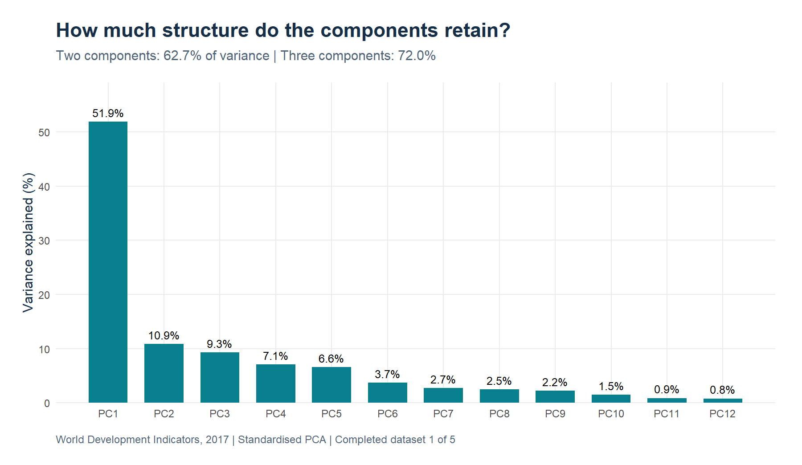
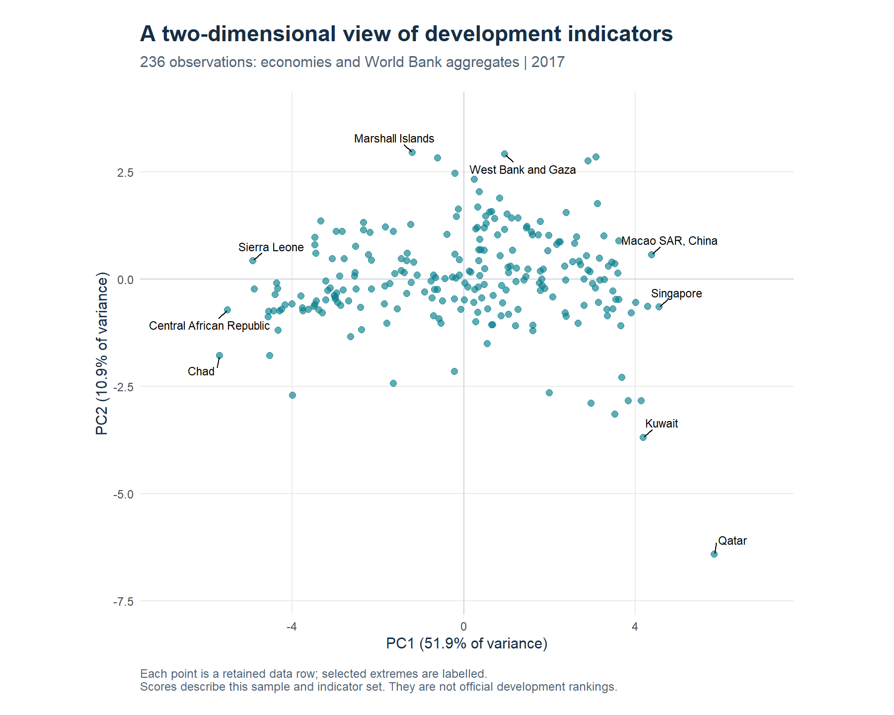

# Principal Component Analysis of World Development Indicators

**Exploring how 12 economic, social and environmental indicators vary together.**

An Introduction to Statistics group project using World Bank data for 2017. The analysis connects the mathematics of PCA with an application in R: standardising the indicators, finding the principal components, and interpreting the variation they capture.

**[Read the original report](PCA_report.pdf)** · **[Explore the methodology](docs/methodology.md)** · **[Run the analysis](#reproduce-the-analysis)**



## At a glance

| Data | Method | Main result |
| --- | --- | --- |
| 2017 World Development Indicators | Standardised PCA in R | PC1 and PC2 retain **62.72%** of variance |
| 12 indicators; 236 retained observations | MICE predictive mean matching for missing values | Three components retain **72.00%** |
| Economies and World Bank aggregates | SVD checked against manual eigendecomposition | Reproduces the report's main variance results |

The sample includes regional and income-group aggregates as well as individual economies. These results describe the supplied dataset; they are not an official ranking of countries.

## What the components show

**PC1: a broad development-related pattern.** The first component explains **51.86%** of variance. Internet use, life expectancy, electricity access and GDP per capita have positive coefficients, while agriculture's share of GDP has a negative coefficient.

**PC2: a contrast in economic structure.** The second component explains **10.86%**. Unemployment has a positive coefficient, while industry share and CO2 emissions have negative coefficients. Its interpretation is distinct from PC1 and accounts for a smaller share of variation.



The first two components provide a useful view of the data, but leave **37.28%** of variation outside the plot. The [variable correlation map](figures/variable-correlations.png) shows how individual indicators relate to these axes. All coefficients and scores are available as [CSV tables](results/).

## Approach

1. Read the supplied CSV and identify the 12 indicators by their World Bank codes.
2. Keep observations with at least 70% of indicators available: 236 of 266 data rows.
3. Impute the remaining 133 missing cells with predictive mean matching, using seed 123.
4. Centre and scale each indicator, then compute PCA with `prcomp()` and check its eigenvalues against a manual eigendecomposition of the correlation matrix.
5. Export explained variance, coefficients, correlations, scores and figures. Compare variance explained across all five completed datasets.

The main figures use the first completed dataset, matching the original approach. Across the five imputations, the first two components retain **62.36% to 63.03%** of variance. This is a limited sensitivity check, not pooled inference. See the [methodology and limitations](docs/methodology.md) for sample details, indicator definitions and interpretation.

## Reproduce the analysis

Install R, then run these commands from the repository root:

```sh
Rscript --vanilla setup.R
Rscript --vanilla Stats_Project.R
Rscript --vanilla tests/verify.R
```

If `Rscript` is not on your PATH, open R or RStudio, set the working directory to this repository, and run:

```r
source("setup.R")
source("Stats_Project.R")
source("tests/verify.R")
```

Setup installs three direct dependencies (`mice`, `ggplot2`, `ggrepel`) and their dependencies into `.R-library/` within this checkout. Internet access is needed for package installation; the analysis itself uses only the bundled data.

The checked-in outputs were generated with **R 4.5.2**. Tested package versions are recorded in [results/package-versions.csv](results/package-versions.csv). Setup installs missing packages rather than enforcing a locked environment, so numerical results may vary with package versions. Each run saves its full R session information locally.

## Repository guide

| File or folder | Contents |
| --- | --- |
| [PCA_report.pdf](PCA_report.pdf) | Original submitted report, including mathematical derivations and both R implementations |
| [Stats_Project.R](Stats_Project.R) | Runnable analysis with corrected plotting and explicit data handling |
| [Data.csv](Data.csv) | Original WDI export for 2017, unchanged |
| [figures/](figures/) | Generated scree plot, correlation map and observation scores |
| [results/](results/) | Generated numerical results, sample audit and imputation comparison |
| [docs/methodology.md](docs/methodology.md) | Method, limitations, data provenance and changes from the original script |
| [tests/verify.R](tests/verify.R) | Numerical consistency and output checks |
| [archive/Stats_Project_original.R](archive/Stats_Project_original.R) | Original standalone script, preserved for reference |

Running the analysis regenerates the figures and tables. The fitted R object, full session information and local package library are excluded from version control.

## Academic context and authorship

Developed for an **Introduction to Statistics** course by **Ali Sinan Dastan, Antonio Perazza and Krystof Kouril**. The original report and analysis are joint work.

The submitted PDF is preserved unchanged. The repository version adds reproducible execution, clearer figures, numerical checks and [documented methodological clarifications](docs/methodology.md#changes-from-the-archived-script).

**Data source:** World Bank, [World Development Indicators](https://databank.worldbank.org/source/world-development-indicators). The supplied export records a database update of 24 March 2025; the report records access on 13 April 2025.
